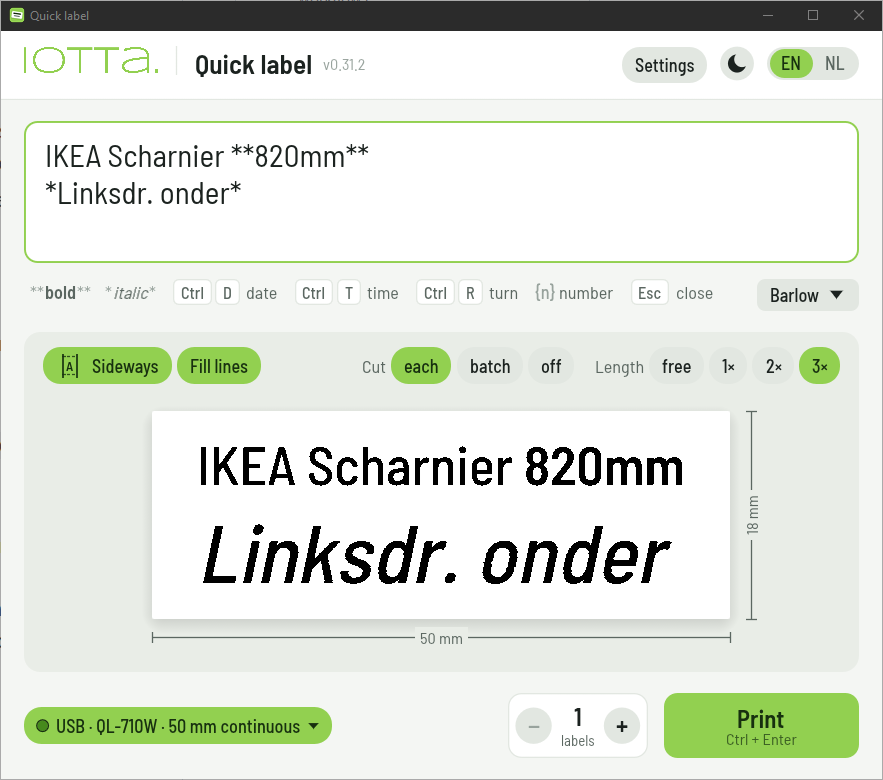
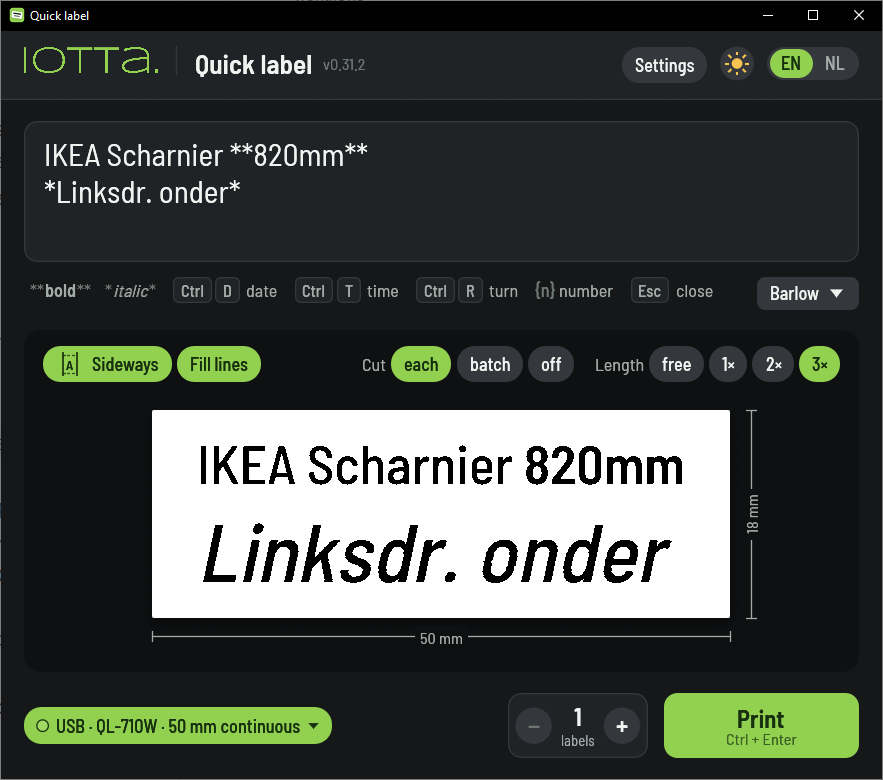
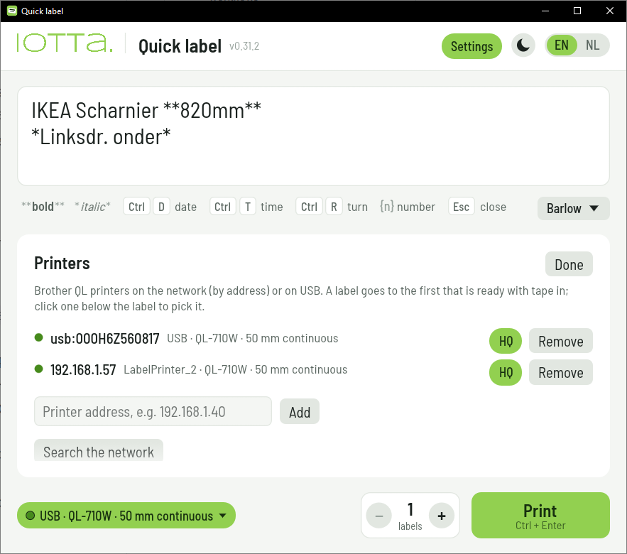

# Quick label

**Type a few lines, press Ctrl+Enter, and the label comes out of your Brother QL.**

No driver, no layout program, no dialogs: a small window under a hotkey that sets your text as
large as it fits on the tape that's loaded, and prints it.



- **No driver.** Nothing from Brother to install: Quick label speaks the printer's own raster
  language, over the network or through Windows' built-in USB printer support.
- **One executable.** A single `.exe` with the fonts and translations embedded, about 13 MB
  (5 MB packed with [UPX](https://upx.github.io/)). Copy it anywhere and it runs; no runtime,
  no installer needed.
- **Simple and fast.** Ctrl+Alt+L opens it (in half a second when it stays ready in the
  background) with the last text ready to type over, Ctrl+Enter prints, Esc closes. The text sets itself as large as it fits: more lines,
  smaller letters.
- **Real WYSIWYG preview.** The preview *is* the print job: the same 300 dpi bitmap that goes to
  the printer, on the tape that is actually loaded, with its size.
- **USB and network, seamlessly.** It reads tape and status from the printer, finds printers on
  the network and on USB by itself, and with several prints on the first one that is ready. The
  same printer on both works too.
- **Keyboard first.** Type, format, turn, set the number of labels and print without touching
  the mouse: the main printing options all have a key.
- **A command line too.** `quicklabel "Rack 4" "**do not move**"` prints without the window:
  every option of the window, numbered series, a PNG instead of a print, the text from stdin,
  exit codes for scripts. [More below](#from-the-command-line).
- **A bit more when you need it.** `**bold**` and `*italic*`, the date and time, sideways labels,
  numbered series (`Box {n}`, 10 at once), three typefaces. English and Dutch, light and dark.



## Install (Windows)

Put `quicklabel.exe` and `install.ps1` in one folder and run `install.ps1` (right click, Run
with PowerShell). It copies the exe and adds Quick label to the Start menu. One file, nothing
else needed: fonts and texts are inside.

The first time, Settings opens by itself: **Search the network** finds the Brother QL printers,
or type one's address. A QL plugged in on USB shows up there by itself.



Works with the QL-710W and QL-810W (tested), and the QL-720NW, 800 and 820NWB. USB needs no
Brother driver: Windows' own "USB Printing Support" does it (not WinUSB/libusb from Zadig).

## Using it

| Key | What it does |
|---|---|
| Ctrl+Enter | Print (the window stays open; Settings: close after printing) |
| Esc | Close |
| Ctrl+B / Ctrl+I | Bold / italic around the selection (or type `**bold**`, `*italic*`) |
| Ctrl+D / Ctrl+T | Today's date / the time |
| Ctrl+R | Lengthwise or sideways |
| Ctrl+F | Fill lines: every line as large as it fits, each its own size |
| Ctrl+Up / Ctrl+Down, Ctrl+N | Number of labels: one more, one less, type it |
| `/` | Back to the text from anywhere in the window |

- **Length** (continuous tape): at most 1×, 2× (default) or 3× the tape's width, or free; the
  text shrinks to fit. Die-cut labels have their own size.
- **Cut** after each label, once after the batch, or off.
- **Numbering:** `{n}` is the label's number from 1, `{n+12}` adds 12 (13, 14, …), `{n+007}`
  keeps the zeros (008, …). All labels go as one job.
- **Typeface:** Barlow (narrow, the default), Roboto or Source Serif 4, for the whole label.
- **HQ** per printer (on by default): 600 dpi along the tape on models that have it, a little
  slower.
- **Several printers:** the printer chip under the label picks one; Automatic takes the first
  that is ready with tape in, and the next one if that one doesn't take the label.

Direction, fill, length and cut are kept per tape size; the typeface, language and theme are
remembered. Settings live in `%APPDATA%\iotta\quicklabel.json`.

### Instantly under the hotkey

Windows takes a few seconds for a shortcut's key. Settings → **Stay ready in the background**
starts a small idle process with Windows (`quicklabel --resident`, a few MB) that holds
Ctrl+Alt+L; the window is then there in about half a second. A tray icon opens Quick label or
switches it off again.

## From the command line

With text it prints without the window; without arguments it opens the window.
`quicklabel --help` lists every option.

```bat
quicklabel "Rack 4" "**do not move**"            :: two lines, on the first printer that is ready
quicklabel -p 2 -n 10 "Box {n}"                  :: ten labels, Box 1 to Box 10, on printer 2
quicklabel --sideways --length 2 --cut batch "Spare parts"
quicklabel --font serif --no-hq "Archive\n2026"  :: \n is a new line too
echo Hello | quicklabel -                        :: the text from stdin
quicklabel --png label.png "Test"                :: the label as an image, not printed
quicklabel --list-printers                       :: the printers and their numbers for -p (--search: new ones)
```

- Every argument is a line. The options are the window's chips (`--sideways`, `--fill-lines`,
  `--cut each|batch|off`, `--length free|1|2|3`), `-n` labels, `--font barlow|roboto|serif`,
  `--hq` / `--no-hq`; each `--x` has a `--no-x`. What isn't given comes from the settings; the
  command line changes none.
- `-p` takes a number from `--list-printers` or an address (`192.168.1.57`,
  `usb:000H6Z560817`).
- Exit code 0 printed, 1 not printed, 2 wrong options.
- `quicklabel.com` next to the exe is a small console program that cmd waits for (`.com` comes
  before `.exe`): it starts the exe and passes on its output and exit code.

For troubleshooting: `QUICKLABEL_JOB=x.bin` saves the job's bytes instead of printing,
`QL_USB_TRACE=1` logs every USB read and write, `--abort usb:…` stops a job a USB printer hangs
on.

## Build

```bash
cargo build --release --target x86_64-pc-windows-gnu      # from Linux/WSL, with mingw-w64
cargo run -- [--text "…"] [--screenshot shot.png] [--dark | --light]
cargo test                                                # includes: every text has a Dutch one
```

`build.rs` links `assets/icon.ico` into the Windows exe (needs `x86_64-w64-mingw32-windres`).
Printing, label drawing and the typefaces come from
[ql-raster](https://github.com/eflukx/ql-raster). Texts are English in the code, wrapped in
`t("…")` / `tf("…")`, and Dutch in `i18n/nl.toml`.

## License

MIT or Apache-2.0, at your option. Barlow Semi Condensed is under the SIL Open Font License
(`assets/fonts/OFL-Barlow.txt`). The iotta name and logo are iotta's.
